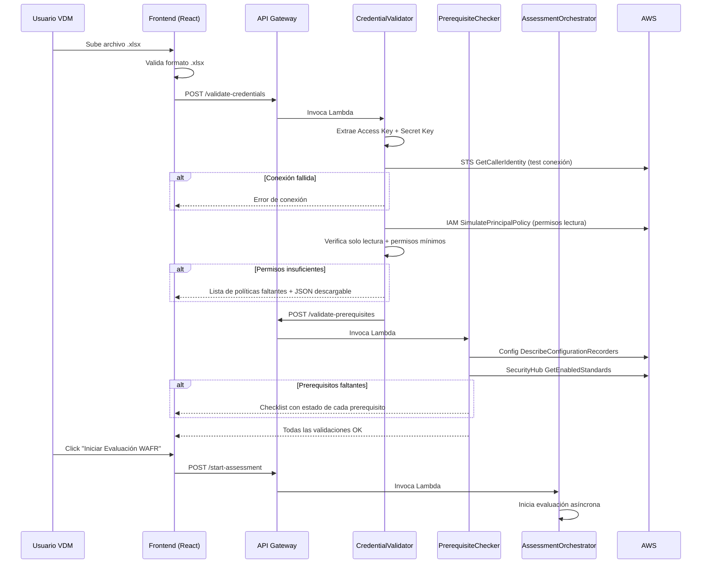
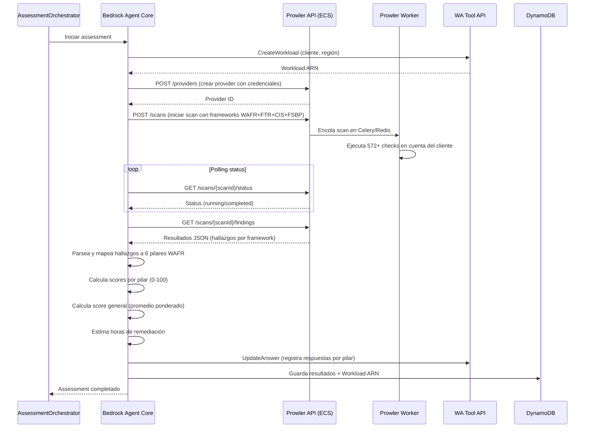

# Diseño Técnico — WAFR Scan Portal

## Visión General

WAFR Scan Portal es una aplicación web serverless que automatiza evaluaciones AWS Well-Architected Framework Review. El sistema sigue un flujo lineal donde el usuario VDM interactúa exclusivamente con nuestro frontend React, mientras que el Bedrock Agent Core orquesta todo el backend: se comunica directamente con la consola AWS del cliente para validar accesos, permisos IAM y prerequisitos (Config + Security Hub), luego invoca a Prowler App (desplegado en ECS) para ejecutar el assessment de seguridad, toma los resultados de Prowler para generar los PDFs personalizados y finalmente los envía por correo.

La arquitectura se basa en servicios gestionados de AWS para minimizar la carga operativa: Amazon Cognito para autenticación, API Gateway + Lambda para la lógica de negocio, Amazon Bedrock Agent Core para la orquestación completa (validaciones + assessment + generación de reportes) usando Amazon Nova Pro como modelo LLM, Prowler App desplegado en Amazon ECS como motor de assessment de seguridad y compliance con su interfaz web accesible para el equipo técnico, y Amazon SES para el envío de correos.

### Decisiones de Diseño Clave

1. **Serverless + ECS híbrido**: La lógica de negocio corre en AWS Lambda (serverless), mientras que Prowler App corre como servicio persistente en ECS Fargate para mantener su interfaz web disponible.
2. **Prowler como motor de assessment**: En lugar de construir la lógica de evaluación desde cero, se usa Prowler (open source, 572+ checks para AWS) que ya tiene los checks mapeados a frameworks WAFR, FTR, CIS, FSBP y PCI DSS.
3. **Bedrock Agent Core como orquestador central**: El agente coordina TODO el flujo backend: valida accesos y permisos IAM contra la consola AWS del cliente, invoca Prowler vía API para el assessment, parsea resultados, calcula scores, registra en Well-Architected Tool, genera PDFs y envía correos.
4. **Well-Architected Tool API como fuente de verdad**: Se usa `CreateWorkload` y `UpdateAnswer` para registrar formalmente la evaluación, generando un Workload ARN válido para Partner Central.
5. **Credenciales efímeras en memoria**: Las credenciales AWS del cliente nunca se persisten en disco ni en base de datos; solo existen en memoria durante la ejecución.
6. **Frontend SPA con React**: Interfaz de usuario como Single Page Application que se comunica con el backend vía API Gateway.
7. **Prowler UI accesible**: La interfaz web de Prowler queda disponible para el equipo técnico para visualizar dashboards, drill down en hallazgos y attack paths.

## Arquitectura

### Diagrama de Arquitectura General

```mermaid
graph TB
    subgraph "Frontend"
        SPA["React SPA<br/>(S3 + CloudFront)"]
    end

    subgraph "Autenticación"
        Cognito["Amazon Cognito<br/>User Pool"]
    end

    subgraph "API Layer"
        APIGW["API Gateway<br/>(REST API)"]
    end

    subgraph "Lógica de Negocio"
        LambdaForm["Lambda<br/>FormHandler"]
        LambdaValidate["Lambda<br/>CredentialValidator"]
        LambdaPrereq["Lambda<br/>PrerequisiteChecker"]
        LambdaAssess["Lambda<br/>AssessmentOrchestrator"]
        LambdaPDF["Lambda<br/>PDFGenerator"]
        LambdaEmail["Lambda<br/>EmailSender"]
    end

    subgraph "Orquestación WAFR"
        Agent["Bedrock Agent Core"]
    end

    subgraph "Prowler App (ECS Fargate)"
        ProwlerAPI["Prowler API<br/>(Django + Celery)"]
        ProwlerUI["Prowler UI<br/>(React)"]
        ProwlerWorker["Celery Worker<br/>(Scan Executor)"]
    end

    subgraph "Prowler Data Layer"
        RDS["Amazon RDS<br/>(PostgreSQL)"]
        Redis["Amazon ElastiCache<br/>(Redis)"]
    end

    subgraph "Servicios AWS"
        WATool["Well-Architected<br/>Tool API"]
        SES["Amazon SES"]
        DynamoDB["DynamoDB<br/>(Historial)"]
        ALB["Application<br/>Load Balancer"]
    end

    SPA --> Cognito
    SPA --> APIGW
    APIGW --> Cognito
    APIGW --> LambdaForm
    APIGW --> LambdaValidate
    APIGW --> LambdaPrereq
    APIGW --> LambdaAssess
    APIGW --> LambdaPDF
    APIGW --> LambdaEmail

    LambdaAssess --> Agent
    Agent --> ProwlerAPI
    ProwlerAPI --> ProwlerWorker
    ProwlerWorker --> Redis
    ProwlerAPI --> RDS
    Agent --> WATool

    ALB --> ProwlerUI
    ALB --> ProwlerAPI

    LambdaEmail --> SES
    LambdaForm --> DynamoDB
    LambdaAssess --> DynamoDB
end
```

### Diagrama de Flujo de Validación



### Diagrama de Flujo del Assessment con Prowler



## Componentes e Interfaces

### 1. Frontend (React SPA)

**Responsabilidad**: Interfaz de usuario, validación de formularios del lado del cliente, gestión de estado del flujo.

**Tecnología**: React + TypeScript, desplegado en S3 + CloudFront.

**Páginas principales**:
- `/login` — Formulario de autenticación con Cognito
- `/scan` — Formulario de información + carga de credenciales + validaciones + ejecución
- `/history` — Historial de evaluaciones del usuario

**Interfaz con Backend**:
```typescript
// API Client
interface WafrApiClient {
  login(email: string, password: string): Promise<AuthTokens>;
  submitScanForm(data: ScanFormData): Promise<{ scanId: string }>;
  uploadCredentials(scanId: string, file: File): Promise<void>;
  validateCredentials(scanId: string): Promise<ValidationResult>;
  validatePrerequisites(scanId: string): Promise<PrerequisiteResult>;
  startAssessment(scanId: string): Promise<{ assessmentId: string }>;
  getAssessmentStatus(assessmentId: string): Promise<AssessmentStatus>;
  downloadPdf(assessmentId: string, type: 'ready' | 'detail'): Promise<Blob>;
  getHistory(): Promise<AssessmentSummary[]>;
}
```

### 2. API Gateway (REST API)

**Responsabilidad**: Punto de entrada HTTP, autorización con Cognito Authorizer, enrutamiento a Lambdas.

**Endpoints**:

| Método | Ruta | Lambda | Descripción |
|--------|------|--------|-------------|
| POST | `/auth/login` | — | Cognito Hosted UI / SDK |
| POST | `/scans` | FormHandler | Crear nuevo scan con datos del formulario |
| POST | `/scans/{scanId}/credentials` | CredentialValidator | Subir y validar credenciales |
| GET | `/scans/{scanId}/permissions` | CredentialValidator | Validar permisos de las credenciales |
| GET | `/scans/{scanId}/prerequisites` | PrerequisiteChecker | Validar Config + Security Hub |
| GET | `/scans/{scanId}/iam-policy` | CredentialValidator | Descargar JSON de política IAM mínima |
| POST | `/scans/{scanId}/assessment` | AssessmentOrchestrator | Iniciar evaluación WAFR |
| GET | `/assessments/{assessmentId}/status` | AssessmentOrchestrator | Estado de la evaluación |
| GET | `/assessments/{assessmentId}/pdf/{type}` | PDFGenerator | Descargar PDF (ready/detail) |
| GET | `/scans` | FormHandler | Historial de scans del usuario |
| GET | `/scans/{scanId}/prowler-link` | AssessmentOrchestrator | Enlace directo a Prowler UI para ver resultados interactivos |

Todos los endpoints (excepto `/auth/*`) requieren un token JWT válido de Cognito en el header `Authorization`.

### 3. Lambda: FormHandler

**Responsabilidad**: Gestionar la creación y consulta de scans.

```typescript
interface FormHandler {
  createScan(userId: string, data: ScanFormData): Promise<Scan>;
  getScanHistory(userId: string): Promise<ScanSummary[]>;
  getScan(scanId: string): Promise<Scan>;
}
```

### 4. Lambda: CredentialValidator

**Responsabilidad**: Extraer credenciales del Excel, validar conexión, verificar permisos de solo lectura y permisos mínimos. Invocada por el Agent Core como parte del flujo de validación contra la consola AWS del cliente.

```typescript
interface CredentialValidator {
  extractCredentials(fileBuffer: Buffer): Promise<AwsCredentials>;
  testConnection(credentials: AwsCredentials, region: string): Promise<ConnectionResult>;
  validateReadOnly(credentials: AwsCredentials): Promise<PermissionResult>;
  validateMinimumPermissions(credentials: AwsCredentials): Promise<PermissionResult>;
  generateMinimumIamPolicy(): IamPolicyDocument;
}
```

**Lógica de validación de permisos** (Agent Core → Lambda → AWS del cliente):
1. Usa `STS GetCallerIdentity` para verificar que las credenciales son válidas y pueden conectarse.
2. Usa `IAM SimulatePrincipalPolicy` para verificar que acciones de escritura (e.g., `ec2:TerminateInstances`) retornen `implicitDeny`.
3. Usa `IAM SimulatePrincipalPolicy` para verificar que acciones de lectura requeridas retornen `allowed`.
4. Verifica que las políticas managed `SecurityAudit` y `ViewOnlyAccess` estén adjuntas.
5. Verifica los permisos adicionales de la `prowler-additions-policy` (account, appstream, backup, bedrock, cognito, ecr, glue, lambda, macie2, shield, ssm, etc.).
6. Excepciones de escritura permitidas: `wellarchitected:CreateWorkload`, `wellarchitected:UpdateAnswer`, `wellarchitected:AssociateLenses`, `securityhub:BatchImportFindings`.

### 5. Lambda: PrerequisiteChecker

**Responsabilidad**: Verificar que AWS Config y Security Hub estén habilitados con los estándares requeridos en la cuenta del cliente. Invocada por el Agent Core como parte del flujo de validación.

```typescript
interface PrerequisiteChecker {
  checkAwsConfig(credentials: AwsCredentials, region: string): Promise<ConfigStatus>;
  checkSecurityHub(credentials: AwsCredentials, region: string): Promise<SecurityHubStatus>;
  getPrerequisiteStatus(scanId: string): Promise<PrerequisiteResult>;
}
```

**Lógica de validación de prerequisitos** (Agent Core → Lambda → AWS del cliente):
1. Usa `Config DescribeConfigurationRecorders` para verificar que AWS Config esté habilitado.
2. Usa `SecurityHub GetEnabledStandards` para verificar estándares activos (FSBP, CIS, PCI DSS).

### 6. Lambda: AssessmentOrchestrator

**Responsabilidad**: Coordinar la ejecución del assessment WAFR invocando al Bedrock Agent Core, que a su vez usa Prowler App como motor de assessment.

```typescript
interface AssessmentOrchestrator {
  startAssessment(scanId: string): Promise<Assessment>;
  getAssessmentStatus(assessmentId: string): Promise<AssessmentStatus>;
  createWorkload(params: WorkloadParams): Promise<{ workloadArn: string }>;
  recordPillarResults(workloadArn: string, pillarResults: PillarResult[]): Promise<void>;
}
```

### 7. Bedrock Agent Core + Prowler App

**Responsabilidad**: El Agent Core orquesta el flujo completo del assessment. Usa Amazon Nova Pro como modelo LLM para análisis de hallazgos, clasificación por severidad, generación de remediaciones y estimación de horas. Invoca a Prowler App vía su API REST para ejecutar los checks de seguridad, parsea los resultados y los mapea a los 6 pilares WAFR.

**Modelo LLM**: Amazon Nova Pro (`amazon.nova-pro-v1:0`) — $0.80/1M input tokens, $3.20/1M output tokens.

**Flujo del Agent Core**:
1. Crea un workload en WA Tool API (`CreateWorkload`).
2. Crea un provider en Prowler API con las credenciales del cliente.
3. Lanza un scan en Prowler con los frameworks: AWS Well-Architected, FTR, CIS, FSBP, PCI DSS.
4. Hace polling del estado del scan hasta que complete.
5. Obtiene los hallazgos (findings) del scan vía API.
6. Parsea y mapea los hallazgos a los 6 pilares WAFR.
7. Calcula scores por pilar y score general.
8. Estima horas de remediación.
9. Registra respuestas en WA Tool API (`UpdateAnswer`).

```typescript
interface ProwlerClient {
  createProvider(credentials: AwsCredentials, region: string): Promise<{ providerId: string }>;
  startScan(providerId: string, frameworks: string[]): Promise<{ scanId: string }>;
  getScanStatus(scanId: string): Promise<ProwlerScanStatus>;
  getFindings(scanId: string): Promise<ProwlerFinding[]>;
}

interface ProwlerFinding {
  checkId: string;
  resourceArn: string;
  status: 'FAIL' | 'PASS' | 'INFO' | 'WARN';
  severity: 'critical' | 'high' | 'medium' | 'low' | 'informational';
  description: string;
  remediation: string;
  compliance: Record<string, string[]>; // framework -> controls
  service: string;
  region: string;
}

interface PillarResult {
  pillarName: string;
  score: number; // 0-100
  findings: Finding[];
  estimatedRemediationHours: number;
  totalChecks: number;
  passedChecks: number;
  failedChecks: number;
}

interface Finding {
  resourceArn: string;
  description: string;
  severity: 'critical' | 'high' | 'medium';
  remediationSteps: string[];
  pillar: string;
  prowlerCheckId: string;
}
```

### 7.1. Prowler App (Amazon ECS Fargate)

**Responsabilidad**: Motor de assessment de seguridad y compliance. Ejecuta 572+ checks sobre cuentas AWS y proporciona interfaz web para visualización interactiva.

**Estrategia de despliegue**: Se utilizan las imágenes Docker oficiales de Docker Hub (no se clona el repositorio de GitHub). ECS Fargate jala las imágenes directamente de Docker Hub. El Worker usa Fargate Spot para reducir costos un 70%. Para actualizaciones, solo se cambia el tag de la imagen en la task definition.

**Componentes ECS**:

| Servicio | Imagen | Recursos | Descripción |
|----------|--------|----------|-------------|
| prowler-api | `prowlercloud/prowler:latest` | 2 vCPU, 4GB RAM | API REST (Django) + Celery beat |
| prowler-worker | `prowlercloud/prowler:latest` | 4 vCPU, 8GB RAM (Fargate Spot) | Celery worker que ejecuta los scans |
| prowler-ui | `prowlercloud/prowler-ui:latest` | 1 vCPU, 2GB RAM | Interfaz web React |

**Infraestructura de soporte**:

| Servicio | Tipo | Descripción |
|----------|------|-------------|
| Amazon RDS | PostgreSQL 15, db.t3.medium | Base de datos persistente de Prowler |
| Amazon ElastiCache | Redis 7, cache.t3.small | Broker de mensajes para Celery |
| Application Load Balancer | ALB con HTTPS | Punto de entrada para UI y API de Prowler |
| Security Groups | Ingress controlado | UI/API accesible solo desde IPs autorizadas |

**Networking**:
- Prowler App desplegada en subnets privadas de la VPC.
- ALB en subnets públicas con certificado ACM para HTTPS.
- Security Groups permiten acceso a la UI solo desde IPs del equipo.
- La API de Prowler es accesible desde las Lambdas del portal vía VPC endpoints o subnets compartidas.

### 8. Lambda: PDFGenerator

**Responsabilidad**: Generar los dos reportes PDF a partir de los resultados del assessment.

```typescript
interface PDFGenerator {
  generateReadyPdf(assessment: AssessmentResult, scanInfo: ScanInfo): Promise<Buffer>;
  generateDetailPdf(assessment: AssessmentResult, scanInfo: ScanInfo, workloadArn: string): Promise<Buffer>;
}
```

### 9. Lambda: EmailSender

**Responsabilidad**: Enviar los PDFs por correo usando Amazon SES con lógica de reintentos.

```typescript
interface EmailSender {
  sendReadyReport(recipientEmail: string, pdfBuffer: Buffer, subject: string): Promise<SendResult>;
  sendDetailReport(pdfBuffer: Buffer, subject: string): Promise<SendResult>;
}
```

**Lógica de reintentos**: Hasta 3 intentos con intervalos de 30 segundos. Si falla, marca el envío como fallido y notifica al frontend.

## Modelos de Datos

### Scan

```typescript
interface Scan {
  scanId: string;           // UUID generado al crear el scan
  userId: string;           // ID del usuario Cognito
  partnerName: string;
  partnerEmail: string;
  country: string;
  clientName: string;
  awsAccountNumber: string;
  awsRegion: string;
  status: ScanStatus;
  prowlerScanId?: string;   // ID del scan en Prowler App
  prowlerUiLink?: string;   // URL directa a Prowler UI para este scan
  createdAt: string;        // ISO 8601
  updatedAt: string;
}

type ScanStatus = 
  | 'form_submitted'
  | 'credentials_uploaded'
  | 'connection_validated'
  | 'permissions_validated'
  | 'prerequisites_validated'
  | 'assessment_in_progress'
  | 'assessment_completed'
  | 'assessment_failed'
  | 'pdfs_generated'
  | 'emails_sent'
  | 'emails_failed';
```

### Assessment

```typescript
interface Assessment {
  assessmentId: string;
  scanId: string;
  workloadArn: string;
  status: AssessmentExecutionStatus;
  overallScore: number;
  pillarResults: PillarResult[];
  startedAt: string;
  completedAt?: string;
}

type AssessmentExecutionStatus = 'running' | 'completed' | 'partial_failure' | 'failed';
```

### PillarResult

```typescript
interface PillarResult {
  pillarName: PillarName;
  score: number;                      // 0-100
  findings: Finding[];
  estimatedRemediationHours: number;
  status: 'completed' | 'error';
  errorMessage?: string;
}

type PillarName = 
  | 'operational_excellence'
  | 'security'
  | 'reliability'
  | 'performance_efficiency'
  | 'cost_optimization'
  | 'sustainability';
```

### Finding

```typescript
interface Finding {
  findingId: string;
  resourceArn: string;
  description: string;
  severity: 'critical' | 'high' | 'medium';
  pillar: PillarName;
  remediationSteps: string[];
  remediationConsoleUrl?: string;
}
```

### ValidationResult

```typescript
interface ValidationResult {
  connectionValid: boolean;
  connectionError?: string;
  permissionsValid: boolean;
  missingPermissions?: MissingPermission[];
  hasWriteAccess: boolean;
}

interface MissingPermission {
  service: string;
  actions: string[];
}
```

### PrerequisiteResult

```typescript
interface PrerequisiteResult {
  allPassed: boolean;
  configEnabled: boolean;
  configRecording: boolean;
  securityHubEnabled: boolean;
  standards: {
    fsbp: boolean;    // AWS Foundational Security Best Practices
    cis: boolean;     // CIS AWS Foundations Benchmark
    pciDss: boolean;  // PCI DSS
  };
}
```

### ScanFormData (Input del formulario)

```typescript
interface ScanFormData {
  partnerName: string;
  partnerEmail: string;
  country: string;
  clientName: string;
  awsAccountNumber: string;
  awsRegion: string;
}
```

### DynamoDB Tables

**Tabla: Scans**
- Partition Key: `userId` (String)
- Sort Key: `scanId` (String)
- GSI: `scanId-index` (PK: `scanId`) para búsquedas directas por scanId

**Tabla: Assessments**
- Partition Key: `scanId` (String)
- Sort Key: `assessmentId` (String)
- GSI: `assessmentId-index` (PK: `assessmentId`)

**Tabla: AuditLog**
- Partition Key: `userId` (String)
- Sort Key: `timestamp` (String, ISO 8601)
- Atributos: `eventType`, `scanId`, `details` (sin credenciales)


## Propiedades de Correctitud

*Una propiedad es una característica o comportamiento que debe mantenerse verdadero en todas las ejecuciones válidas de un sistema — esencialmente, una declaración formal sobre lo que el sistema debe hacer. Las propiedades sirven como puente entre especificaciones legibles por humanos y garantías de correctitud verificables por máquinas.*

### Propiedad 1: Protección de rutas sin JWT válido

*Para cualquier* solicitud HTTP a un endpoint protegido que no incluya un token JWT válido, el sistema debe rechazar la solicitud con un código 401 y no ejecutar la lógica del endpoint.

**Valida: Requisito 1.4**

### Propiedad 2: Validación de formulario con campos inválidos

*Para cualquier* envío del formulario de scan donde uno o más campos obligatorios estén vacíos o contengan valores inválidos (incluyendo correos con formato incorrecto), el sistema debe rechazar el envío y retornar un mensaje de error específico para cada campo inválido.

**Valida: Requisitos 2.1, 2.3, 2.4, 2.5**

### Propiedad 3: Selección de exactamente una región AWS

*Para cualquier* envío del formulario de scan, el campo de región debe contener exactamente un valor que pertenezca a la lista predefinida de regiones AWS disponibles.

**Valida: Requisito 2.2**

### Propiedad 4: Rechazo de archivos con formato no .xlsx

*Para cualquier* archivo cargado cuya extensión no sea `.xlsx`, el sistema debe rechazar el archivo y no intentar extraer credenciales.

**Valida: Requisito 3.2**

### Propiedad 5: Round-trip de extracción de credenciales del Excel

*Para cualquier* par válido de access key y secret key escritos en un archivo Excel (.xlsx), al extraer las credenciales del archivo, los valores extraídos deben ser idénticos a los valores originales.

**Valida: Requisito 3.3**

### Propiedad 6: Rechazo de credenciales con permisos de escritura

*Para cualquier* conjunto de políticas IAM que incluya permisos de escritura, eliminación o modificación sobre recursos del cliente (excluyendo `wellarchitected:*`), el validador debe rechazar las credenciales e indicar que solo se aceptan permisos de solo lectura.

**Valida: Requisitos 3.1.1, 3.1.2**

### Propiedad 7: Detección de permisos de lectura faltantes

*Para cualquier* conjunto de políticas IAM que carezca de uno o más permisos de lectura requeridos, el validador debe identificar correctamente todos los permisos faltantes y retornarlos agrupados por servicio AWS.

**Valida: Requisitos 3.1.3, 3.1.5**

### Propiedad 8: Bloqueo de evaluación por prerequisitos incompletos

*Para cualquier* resultado de validación de prerequisitos donde `allPassed` sea `false`, el sistema debe impedir el inicio de la evaluación WAFR y renderizar cada prerequisito con su estado correcto (activo/inactivo).

**Valida: Requisitos 3.2.6, 3.2.7**

### Propiedad 9: Completitud de la evaluación en 6 pilares

*Para cualquier* evaluación WAFR completada exitosamente, el resultado debe contener exactamente 6 resultados de pilar, uno por cada pilar del Well-Architected Framework.

**Valida: Requisito 4.1**

### Propiedad 10: Invariantes del modelo de datos del assessment

*Para cualquier* resultado de evaluación WAFR, cada hallazgo debe tener una severidad válida (`critical`, `high` o `medium`), cada pilar debe tener una calificación entre 0 y 100, cada hallazgo debe incluir `resourceArn`, `description` y `remediationSteps` no vacíos, y cada pilar debe tener un `estimatedRemediationHours` no negativo.

**Valida: Requisitos 4.3, 4.4, 4.6, 4.7**

### Propiedad 11: Calificación general como promedio ponderado

*Para cualquier* conjunto de 6 calificaciones de pilar, la calificación general calculada debe ser igual al promedio ponderado de las calificaciones individuales según los pesos definidos.

**Valida: Requisito 4.5**

### Propiedad 12: Resiliencia ante fallo parcial de pilares

*Para cualquier* evaluación donde uno o más pilares fallen con error, los pilares restantes deben completarse normalmente y el resultado debe incluir tanto los pilares exitosos como los fallidos con su estado de error.

**Valida: Requisito 4.10**

### Propiedad 13: Round-trip del Workload ARN en historial

*Para cualquier* evaluación completada con un Workload ARN, al consultar el historial del usuario, la evaluación debe aparecer con el mismo Workload ARN que fue generado.

**Valida: Requisito 4.1.7**

### Propiedad 14: Contenido completo del PDF WAFR Ready

*Para cualquier* resultado de evaluación y datos de scan, el PDF Ready generado debe contener: los hallazgos ordenados por severidad dentro de cada pilar, la calificación de cada pilar, la calificación general, las horas estimadas de remediación por pilar, y el encabezado con nombre del partner, cliente, consola, región y fecha.

**Valida: Requisitos 5.2, 5.3, 5.4, 5.5**

### Propiedad 15: Contenido completo del PDF WAFR Detail

*Para cualquier* resultado de evaluación, datos de scan y Workload ARN, el PDF Detail generado debe contener: el Workload ARN en el encabezado, cada hallazgo con su ARN de recurso, descripción, severidad y pasos de remediación, los hallazgos agrupados por pilar, el encabezado con datos del scan, y un checklist de remediación por pilar ordenado por severidad con casilla de verificación, nombre del hallazgo, ARN del recurso y referencia a la página del detalle.

**Valida: Requisitos 4.1.6, 6.2, 6.3, 6.4, 6.5, 6.6, 6.7**

### Propiedad 16: Ordenamiento de hallazgos por severidad

*Para cualquier* lista de hallazgos dentro de un pilar, tanto en el PDF Ready como en el checklist del PDF Detail, los hallazgos deben estar ordenados por severidad: crítica primero, luego alta, luego media.

**Valida: Requisitos 5.2, 6.6**

### Propiedad 17: Formato del asunto del correo electrónico

*Para cualquier* nombre de cliente y fecha de evaluación, el asunto del correo generado debe contener ambos valores.

**Valida: Requisito 7.3**

### Propiedad 18: Lógica de reintentos del servicio de correo

*Para cualquier* envío de correo que falle, el servicio debe reintentar exactamente hasta 3 veces con intervalos de 30 segundos antes de declarar el envío como fallido.

**Valida: Requisito 7.4**

### Propiedad 19: Ausencia de credenciales en logs de auditoría

*Para cualquier* entrada en el log de auditoría, el contenido no debe contener patrones de access key (`AKIA...`) ni secret key de AWS.

**Valida: Requisito 8.3**

## Manejo de Errores

### Errores de Autenticación
- **Token JWT expirado**: Retornar 401 y redirigir al login. El frontend intercepta respuestas 401 y limpia el estado de sesión.
- **Token JWT inválido/ausente**: Retornar 401. API Gateway Cognito Authorizer rechaza la solicitud antes de llegar a la Lambda.

### Errores de Validación de Formulario
- **Campos vacíos o inválidos**: Retornar 400 con un objeto que mapea cada campo inválido a su mensaje de error específico.
- **Región no válida**: Retornar 400 indicando que la región no está en la lista permitida.

### Errores de Credenciales
- **Archivo no .xlsx**: Rechazar en el frontend antes de subir. Si llega al backend, retornar 400.
- **Excel sin credenciales válidas**: Retornar 400 indicando que no se encontraron access key y secret key en el formato esperado.
- **Conexión fallida**: Retornar 400 con el mensaje de error de AWS STS (e.g., `InvalidClientTokenId`, `SignatureDoesNotMatch`).
- **Permisos de escritura detectados**: Retornar 403 con la lista de acciones de escritura encontradas.
- **Permisos de lectura faltantes**: Retornar 400 con la lista de permisos faltantes agrupados por servicio + enlace para descargar la política IAM mínima.

### Errores de Prerequisitos
- **Config/Security Hub no habilitado**: Retornar 400 con el checklist de prerequisitos y sus estados, incluyendo instrucciones de activación.

### Errores de Evaluación WAFR
- **Fallo en un pilar**: El agente registra el error, marca el pilar como `error` y continúa con los demás. El resultado final tiene status `partial_failure`.
- **Fallo total del agente**: Retornar 500, registrar en logs, marcar el assessment como `failed`. El usuario puede reintentar.
- **Timeout de Lambda**: Configurar timeout adecuado (15 min máximo para el orquestador). Si se excede, marcar como `failed`.
- **Error en CreateWorkload**: Retornar error específico. No se puede continuar sin Workload ARN.

### Errores de Prowler App
- **Prowler API no disponible**: Retornar 503, registrar error. El usuario puede reintentar cuando el servicio esté disponible.
- **Scan de Prowler falla**: Registrar el error de Prowler, marcar assessment como `failed`. Ofrecer reintentar.
- **Timeout del scan de Prowler**: Si el scan excede el tiempo máximo esperado (configurable), cancelar y marcar como `failed`.
- **Error al crear provider en Prowler**: Retornar error indicando que las credenciales no pudieron ser configuradas en el motor de assessment.

### Errores de Generación de PDF
- **Fallo en generación**: Retornar 500, registrar error. El usuario puede reintentar la generación desde el portal.
- **PDF demasiado grande**: Limitar hallazgos por página y paginar si es necesario.

### Errores de Envío de Correo
- **Fallo en SES**: Reintentar hasta 3 veces con intervalos de 30 segundos.
- **Fallo después de 3 reintentos**: Marcar como `emails_failed`, notificar al usuario y ofrecer descarga directa de PDFs.
- **Dirección de correo rechazada por SES**: Registrar el error y ofrecer descarga directa.

### Códigos de Error HTTP

| Código | Uso |
|--------|-----|
| 400 | Validación fallida (formulario, credenciales, prerequisitos) |
| 401 | Token JWT ausente, inválido o expirado |
| 403 | Credenciales con permisos de escritura |
| 404 | Scan o assessment no encontrado |
| 500 | Error interno (fallo de Lambda, error de AWS API) |
| 503 | Servicio temporalmente no disponible (SES, Bedrock) |

## Estrategia de Testing

### Enfoque Dual: Tests Unitarios + Tests de Propiedades

La estrategia de testing combina tests unitarios para casos específicos y edge cases con tests basados en propiedades (property-based testing) para verificar invariantes universales.

### Librería de Property-Based Testing

Se utilizará **fast-check** para TypeScript/JavaScript, que es la librería PBT más madura del ecosistema Node.js.

```bash
npm install --save-dev fast-check
```

### Configuración de Tests de Propiedades

- Cada test de propiedad debe ejecutar un mínimo de **100 iteraciones**.
- Cada test debe incluir un comentario de referencia al documento de diseño:
  ```typescript
  // Feature: wafr-scan-portal, Property 1: Protección de rutas sin JWT válido
  ```
- Cada propiedad de correctitud debe ser implementada por **un único test de propiedad**.

### Tests Unitarios

Los tests unitarios se enfocan en:

- **Ejemplos específicos**: Verificar comportamiento con datos concretos conocidos.
- **Edge cases**: Archivos vacíos, campos con caracteres especiales, listas de hallazgos vacías.
- **Integración entre componentes**: Flujo completo de validación (conexión → permisos → prerequisitos).
- **Condiciones de error**: Respuestas de error de AWS, timeouts, formatos inesperados.

### Tests de Propiedades (por Propiedad de Correctitud)

| Propiedad | Componente bajo test | Generadores necesarios |
|-----------|---------------------|----------------------|
| P1: JWT protection | API middleware | Requests con/sin JWT |
| P2: Form validation | FormHandler | ScanFormData con campos inválidos |
| P3: Region selection | FormHandler | Strings de región válidos/inválidos |
| P4: File format | CredentialValidator | Nombres de archivo con extensiones variadas |
| P5: Credential round-trip | CredentialValidator | Pares access key / secret key |
| P6: Write permission rejection | CredentialValidator | Documentos de política IAM |
| P7: Missing read permissions | CredentialValidator | Subconjuntos de permisos requeridos |
| P8: Prerequisite blocking | PrerequisiteChecker | PrerequisiteResult con combinaciones de estados |
| P9: 6 pillars completeness | AssessmentOrchestrator | Assessment results |
| P10: Data model invariants | Assessment models | PillarResult y Finding aleatorios |
| P11: Weighted average | Score calculator | Arrays de 6 scores (0-100) |
| P12: Partial failure resilience | AssessmentOrchestrator | Combinaciones de pilares exitosos/fallidos |
| P13: Workload ARN round-trip | History store | Assessment con Workload ARN |
| P14: Ready PDF content | PDFGenerator | AssessmentResult + ScanInfo aleatorios |
| P15: Detail PDF content | PDFGenerator | AssessmentResult + ScanInfo + WorkloadArn |
| P16: Severity ordering | Sorting utility | Listas de findings con severidades mixtas |
| P17: Email subject format | EmailSender | Nombres de cliente + fechas |
| P18: Retry logic | EmailSender | Secuencias de éxito/fallo |
| P19: No credentials in logs | AuditLogger | Entradas de log con datos aleatorios |

### Ejemplo de Test de Propiedad

```typescript
import fc from 'fast-check';

// Feature: wafr-scan-portal, Property 16: Ordenamiento de hallazgos por severidad
describe('Severity ordering', () => {
  const severityOrder = { critical: 0, high: 1, medium: 2 };

  it('should order findings by severity: critical > high > medium', () => {
    fc.assert(
      fc.property(
        fc.array(
          fc.record({
            findingId: fc.uuid(),
            severity: fc.constantFrom('critical', 'high', 'medium'),
            resourceArn: fc.string({ minLength: 1 }),
            description: fc.string({ minLength: 1 }),
          }),
          { minLength: 1 }
        ),
        (findings) => {
          const sorted = sortFindingsBySeverity(findings);
          for (let i = 1; i < sorted.length; i++) {
            expect(severityOrder[sorted[i - 1].severity])
              .toBeLessThanOrEqual(severityOrder[sorted[i].severity]);
          }
        }
      ),
      { numRuns: 100 }
    );
  });
});
```

### Tests de Integración

Los tests de integración verifican el flujo completo usando mocks de servicios AWS:
- **aws-sdk-client-mock** para mockear llamadas a STS, IAM, Config, Security Hub, Well-Architected Tool.
- Verificar el flujo: formulario → validación → assessment → PDF → email.
- Verificar manejo de errores end-to-end.
